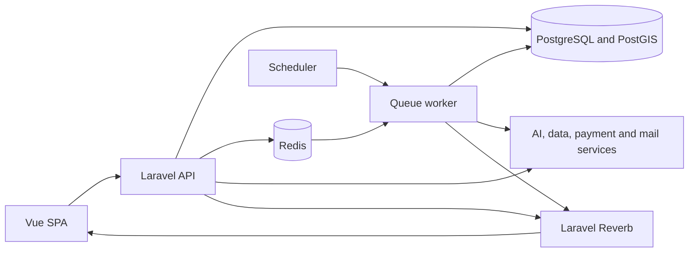

# YieldGrid

**Crop planning, harvest trading, and farming knowledge in one place for Filipino farmers and buyers.**

[](https://github.com/kelason/yield-grid/actions/workflows/ci.yml)

**[Visit YieldGrid](https://yieldgridph.com)** · [Features](https://yieldgridph.com/features) · [How it works](https://yieldgridph.com/how-it-works) · [User guides](https://yieldgridph.com/documentation)

YieldGrid connects farm and plot management with crop recommendations, a produce marketplace,
buyer demands, and a farming community. Farmers can plan what to grow, offer an upcoming or available
harvest, and track their transactions. Buyers can discover produce, publish sourcing requirements,
and manage purchases from their own dashboard.

The interface supports **English, Tagalog, and Cebuano**. Its Field & Linen design uses natural
colors, Lora headings, Inter body text, and reusable, responsive components.

## Contents

- [Features](#features)
- [Technology stack](#technology-stack)
- [Architecture and repository layout](#architecture-and-repository-layout)
- [Local installation with Docker](#local-installation-with-docker)
- [Local installation with host runtimes](#local-installation-with-host-runtimes)
- [Configuration and integrations](#configuration-and-integrations)
- [Testing and quality checks](#testing-and-quality-checks)
- [Troubleshooting](#troubleshooting)
- [Production and deployment](#production-and-deployment)
- [Contributing and further documentation](#contributing-and-further-documentation)
- [License](#license)

## Features

### For farmers

- **Farm and plot management:** maintain farms, draw plot boundaries on an interactive map, record soil
  details, calculate areas, and account for restricted zones.
- **Crop planning:** request background crop analysis with recommendations, compatibility information,
  weather context, and estimated harvest information.
- **Harvest listings:** publish recommendation-based forward contracts or manually list upcoming and
  available harvests, with quantity, pricing, and optional farm provenance.
- **Buyer demand offers:** discover crop requests and submit offers against buyers' requirements.
- **Transaction tracking:** manage orders, delivery progress, balances, and recorded cash payments.
- **Farm verification:** track administrative review and verification status for farms and plots.
- **Trust reports:** view internal credit/trust scores and history, and download QR-verifiable reports.
- **Insurance preparation:** manage PCIC enrollment records, document packs, claims records, reminders,
  and insurance office information.

### For buyers

- Browse the public produce marketplace and purchase available quantities.
- Use hosted online checkout or supported cash-payment workflows.
- Post crop demands and review, accept, or reject farmer offers.
- Track purchases, outstanding balances, and delivery completion.

### Community and shared tools

- Account registration, email verification, password recovery, profiles, and Philippine addresses.
- Transaction messaging and realtime updates through Laravel Reverb.
- Forum threads, categories, tags, replies, votes, accepted answers, and attachments.
- Content reports, support issues, and contact inquiries.
- Public feature pages, walkthroughs, and localized user guides.

### Administration

- Operational overview, user management, and account suspension.
- Farm and plot verification review.
- Contact inquiries, support tickets, and content reports.
- Reversible moderation of supported community and marketplace content.

Crop advice, prices, and yield estimates are decision aids. Some integrations provide fallback or
sample data when live services are unavailable. Trust scores are internal platform indicators;
insurance tools help organize applications and records rather than approve insurance coverage.

## Technology stack

Versions below describe the current repository; lockfiles record the exact installed versions.

| Area                      | Technologies                                                                     |
| ------------------------- | -------------------------------------------------------------------------------- |
| Backend                   | PHP 8.2+; Laravel 12; PHP 8.3.36 in Docker and CI                                   |
| API and authentication    | Laravel REST API, Sanctum, Scramble API documentation                            |
| Frontend                  | Vue 3 Composition API, Vite 8, Pinia 4, Vue Router 5                             |
| Styling and localization  | Tailwind CSS 3.4, Heroicons, Vue I18n 11, self-hosted Inter and Lora             |
| Database                  | PostgreSQL 16 with PostGIS 3.4                                                   |
| Cache and background work | Redis 7, Laravel queues, Horizon, Laravel scheduler                              |
| Realtime                  | Laravel Reverb, Laravel Echo, Pusher-compatible browser client                   |
| Maps and charts           | Leaflet, Leaflet.Draw, Turf, Chart.js, Vue Chart.js                              |
| AI and agricultural data  | Google Gemini, AgroMonitoring, Department of Agriculture price references        |
| Payments                  | PayMongo hosted checkout and webhooks; cash-payment recording                    |
| PDF reports               | Browsershot, Puppeteer/Chrome, QR codes                                          |
| Tests                     | Pest/PHPUnit, Vitest, Vue Test Utils, Playwright                                 |
| Quality and delivery      | Pint, PHPStan/Larastan, ESLint, Oxlint, Prettier, Docker Compose, GitHub Actions |

## Architecture and repository layout

The frontend is a separate Vue single-page application. Laravel exposes the API under `/api/v1`,
persists spatial and transactional data in PostgreSQL, and uses Redis-backed workers for background
tasks. Reverb delivers realtime events to the browser.



```text
yield-grid/
├── backend/
│   ├── app/
│   │   ├── Domain/          # Domain models, actions, DTOs and repository contracts
│   │   ├── Infrastructure/  # External services and repository implementations
│   │   ├── Jobs/            # Queued work
│   │   └── ...              # Context-specific controllers, requests and resources
│   ├── database/            # Migrations, factories, seeders and snapshots
│   ├── routes/              # API, web, broadcast and scheduled-task routes
│   └── tests/               # Backend unit and feature tests
├── frontend/
│   ├── src/
│   │   ├── components/      # Atoms, molecules, organisms and templates
│   │   ├── pages/           # Public, authentication and dashboard routes
│   │   ├── composables/     # Reusable stateful logic
│   │   ├── stores/          # Pinia state
│   │   └── constants/       # Shared limits, configuration and design tokens
│   └── e2e/                 # Playwright behavior and visual coverage
├── docs/                    # Operations, design specifications and implementation plans
├── .github/workflows/       # CI, browser smoke checks and deployment
└── docker-compose.yml       # Complete local development stack
```

Backend code is organized into bounded contexts with Eloquent models in the Domain layer. Project rules
require external integrations to live behind Infrastructure services. Frontend components follow
Atomic Design. See [AGENTS.md](AGENTS.md)
for contribution rules and the [design specification](docs/superpowers/specs/2026-10-07-modern-organic-redesign.md)
for UI contracts.

## Local installation with Docker

This is the recommended way to run the complete application locally. Docker supplies PHP, Node,
PostgreSQL/PostGIS, Redis, Mailpit, Chrome for PDF generation, and the application processes.

### 1. Prerequisites

- Git.
- Docker Desktop, or Docker Engine with the Docker Compose v2 plugin.
- Available ports: `5173`, `8000`, `8081`, `5432`, `6379`, `1025`, and `8025`.
- Internet access for the first image build, dependency downloads, and external map/data services.

### 2. Clone and create local environment files

Run these commands in a terminal:

```sh
git clone --branch main https://github.com/kelason/yield-grid.git
cd yield-grid
cp backend/.env.example backend/.env
cp frontend/.env.example frontend/.env
```

For an existing checkout, preserve your existing `.env` files instead of copying over them.
The frontend example already points to the local API and WebSocket server. Optional integration
credentials belong in `backend/.env`; see [configuration](#configuration-and-integrations).

### 3. Start the stack

From the repository root:

```sh
docker compose up --build -d
docker compose ps
docker compose logs -f backend frontend
```

The first build downloads dependencies and Chrome and can take several minutes. Use `Ctrl+C` to
stop following logs; the containers continue running.

The backend entrypoint generates an application key when needed, creates the public storage link,
and runs migrations. Compose supplies the PostgreSQL, Redis, mail, and realtime settings, overriding
the framework defaults in the example environment file. No separate manual migration or queue
startup is required for this Docker path.

### 4. Open the application

| Service                 | Local address                  |
| ----------------------- | ------------------------------ |
| Web application         | <http://localhost:5173>        |
| API base                | <http://localhost:8000/api/v1> |
| Backend health check    | <http://localhost:8000/up>     |
| API documentation       | <http://localhost:8000/docs>   |
| Mailpit inbox           | <http://localhost:8025>        |
| Reverb WebSocket server | `localhost:8081`               |
| PostgreSQL              | `localhost:5432`               |
| Redis                   | `localhost:6379`               |

Register a farmer or buyer account and open the verification email in Mailpit. The verification
step is required for protected workflows. The API base is a prefix for endpoints, not a separate
homepage.

The local API documentation page needs a generated OpenAPI file. To enable it, run:

```sh
docker compose exec backend mkdir -p storage/app/api-docs
docker compose exec backend php artisan scramble:export --path=storage/app/api-docs/openapi.json
```

Regenerate it after changing API routes or contracts. Without this export, `/docs` returns
"API docs not generated yet"; the application itself can still run.

### 5. Optional local demo accounts

To create verified accounts without importing a database snapshot:

```sh
docker compose exec backend php artisan db:seed --class=DemoUsersSeeder
```

| Role   | Email                     | Local demo password |
| ------ | ------------------------- | ------------------- |
| Farmer | `farmer@example.com`      | `Testing123456!`    |
| Buyer  | `buyer@example.com`       | `Testing123456!`    |
| Admin  | `yieldgridph@example.com` | `Testing123456!`    |

Use this seeder only for local development: rerunning it resets these accounts to the listed
password. These credentials describe local seeded accounts, not access to the production website.

**Seeding note:** the default `DatabaseSeeder` imports `database/seeders/backup.sql` and a price
snapshot when present. A bare `db:seed` is therefore not part of the normal installation steps.
The targeted command above creates accounts only; it does not populate farms or transactions.

### Everyday Docker commands

Run from the repository root:

```sh
# Follow API, background job and realtime logs
docker compose logs -f backend queue reverb scheduler

# Run a Laravel command
docker compose exec backend php artisan migrate:status

# Restart long-running processes after changing backend environment values
docker compose up -d --force-recreate backend queue reverb scheduler

# Stop the local stack while retaining its named data volumes
docker compose down
```

The Compose configuration is for local development. Its example credentials and development servers
are not a production hosting configuration. Adding `-v` to `docker compose down` deletes named volumes,
including the local database.

## Local installation with host runtimes

Use this alternative if you want to run PHP and Vite directly on your machine. The commands below
assume a macOS/Linux shell or WSL2 and a clone with both `.env` files created as shown above.

### 1. Install prerequisites and start supporting services

- PHP 8.3.36 is recommended to match Docker and CI (pinned for CVE-2026-109618 / CVE-2026-109619); the project requires PHP 8.2 or newer, patched to 8.2.35 / 8.3.36 / 8.4.27 / 8.5.12 or later.
- Composer 2.
- Node.js `^22.18.0` or `>=24.12.0`, with npm.
- PostgreSQL 16 with PostGIS 3.4, Redis 7, and an SMTP development inbox.
- PHP extensions used by the stack include `pdo_pgsql`, `pgsql`, `mbstring`, `intl`, `zip`, `bcmath`,
  `exif`, `pcntl`, `sockets`, and `gd`, in addition to Laravel's standard requirements.

You can keep only the supporting services in Docker:

```sh
docker compose up -d postgres redis mailpit
```

If the full Docker stack is already running, stop it with `docker compose down` first so host
processes can bind their ports. When supplying your own PostgreSQL server, create a `yieldgrid`
database and matching user, install PostGIS, and allow the migration user to enable the extension.
SQLite does not support this application's spatial schema.

### 2. Configure the backend

Update the corresponding entries in `backend/.env` with these local values. Add entries that are
missing. The database credentials below match the repository's Compose services.

```dotenv
APP_NAME=YieldGrid
APP_ENV=local
APP_DEBUG=true
APP_URL=http://localhost:8000
FRONTEND_URL=http://localhost:5173

DB_CONNECTION=pgsql
DB_HOST=127.0.0.1
DB_PORT=5432
DB_DATABASE=yieldgrid
DB_USERNAME=yieldgrid
DB_PASSWORD=secret

REDIS_CLIENT=predis
REDIS_HOST=127.0.0.1
REDIS_PORT=6379
QUEUE_CONNECTION=redis
CACHE_STORE=redis
SESSION_DRIVER=database

MAIL_MAILER=smtp
MAIL_SCHEME=null
MAIL_HOST=127.0.0.1
MAIL_PORT=1025
MAIL_USERNAME=null
MAIL_PASSWORD=null

BROADCAST_CONNECTION=reverb
REVERB_APP_ID=123456
REVERB_APP_KEY=yieldgrid_reverb_key
REVERB_APP_SECRET=yieldgrid_reverb_secret
REVERB_HOST=localhost
REVERB_PORT=8081
REVERB_SCHEME=http
REVERB_SERVER_HOST=0.0.0.0
REVERB_SERVER_PORT=8081
```

Predis is included through Composer, so this configuration does not require the PHP Redis extension.
Keep the frontend's `VITE_REVERB_APP_KEY` equal to the backend's `REVERB_APP_KEY`.

### 3. Install backend dependencies and prepare the database

From the repository root:

```sh
cd backend
composer install
npm ci
npx puppeteer browsers install chrome
php artisan key:generate
php artisan migrate
php artisan storage:link
```

For host PDF generation, set `BROWSERSHOT_NODE_MODULE_PATH` in `backend/.env` to the **absolute path**
of `backend/node_modules`; the example file leaves it empty. Keep `BROWSERSHOT_NODE_BINARY=node`
unless Node needs an absolute path. You can also set `BROWSERSHOT_CHROME_PATH` to a system Chrome
binary. Keep `BROWSERSHOT_NO_SANDBOX=false` for a normal host installation. Docker configures its own
browser paths automatically.

Ensure `backend/storage` and `backend/bootstrap/cache` are writable by the PHP process. To add local
demo accounts, run `php artisan db:seed --class=DemoUsersSeeder` from `backend`.

To enable the local API documentation, also run from `backend`:

```sh
mkdir -p storage/app/api-docs
php artisan scramble:export --path=storage/app/api-docs/openapi.json
```

### 4. Run the backend processes

Open a separate terminal for each command, all in `backend`:

```sh
# API server
php artisan serve --host=127.0.0.1 --port=8000
```

```sh
# Background analysis, reports, notifications and other queued work
php artisan queue:work redis --sleep=3 --tries=3 --max-time=3600 --timeout=120
```

```sh
# Realtime events
php artisan reverb:start --host=0.0.0.0 --port=8081 --hostname=localhost
```

```sh
# Scheduled maintenance, price synchronization and reminders
php artisan schedule:work
```

Restart the queue command when its one-hour `--max-time` limit is reached. Docker handles worker
restarts for its own stack. Backend scaffold scripts do not start the separate Vue frontend.

### 5. Install and run the frontend

In a new terminal, from the repository root:

```sh
cd frontend
npm ci --legacy-peer-deps
npm run dev -- --host 127.0.0.1 --port 5173
```

Open <http://localhost:5173>. The `--legacy-peer-deps` install option matches the repository's Docker
and CI commands. Keep using the same browser hostname during login and verification.

## Configuration and integrations

The basic local stack can start without paid-service credentials. Online payments and live external
data require the appropriate provider configuration. Add missing variables to `backend/.env` rather
than placing backend secrets in frontend files.

| Capability                         | Backend configuration                                                                              | Notes                                                                               |
| ---------------------------------- | -------------------------------------------------------------------------------------------------- | ----------------------------------------------------------------------------------- |
| Crop advice and AI price estimates | `GEMINI_API_KEY`, `GEMINI_MODEL`, `GEMINI_FALLBACK_MODEL`                                          | Use models available to your Google account; defaults are in `config/services.php`. |
| Plot weather and soil data         | `AGROMONITORING_API_KEY`                                                                           | Missing keys or provider failures may result in fallback data.                      |
| Online checkout                    | `PAYMONGO_PUBLIC_KEY`, `PAYMONGO_SECRET_KEY`, `PAYMONGO_WEBHOOK_SECRET`                            | Use provider test credentials locally.                                              |
| DA price synchronization           | `DA_PRICE_SYNC_ENABLED`, `DA_PRICE_BASE_URL`, `DA_PRICE_AI_FALLBACK`, `AI_PRICE_ESTIMATES_ENABLED` | Scheduled price sources and AI estimates are configurable.                          |
| Email                              | `MAIL_*`                                                                                           | Docker sends mail to Mailpit; production needs a working mail provider.             |
| Optional SMS                       | `TXTFLOW_ENABLED`, `TXTFLOW_API_KEY`, `TXTFLOW_DEVICE_ID`                                          | Disabled by default.                                                                |
| PDF documents                      | `BROWSERSHOT_*`                                                                                    | Needs working Node, Puppeteer and Chrome in the process that renders the PDF.       |

PayMongo webhooks use `/api/v1/webhooks/paymongo`. Local webhook testing needs a provider-reachable
HTTPS URL routed to that endpoint and its matching webhook secret.

The browser reads these values from `frontend/.env`:

```dotenv
VITE_API_URL=http://localhost:8000/api/v1
VITE_REVERB_APP_KEY=yieldgrid_reverb_key
VITE_REVERB_HOST=localhost
VITE_REVERB_PORT=8081
VITE_REVERB_SCHEME=http
```

`VITE_*` values are exposed to the browser and baked into production builds. Only public connection
settings belong there. Restart Vite after changing its environment file; rebuild for production.
For backend configuration changes, clear cached configuration with `php artisan config:clear` and
restart long-running workers/Reverb. In Docker, prefix the command with `docker compose exec backend`
and recreate the backend services as shown above to reload their environment files.

## Testing and quality checks

### Backend

Backend tests require PostgreSQL/PostGIS and a **separate test database**. Test cases reset data;
never point them at a development database containing work you need or at production.

For the Docker stack, create the test database once:

```sh
docker compose exec postgres createdb -U yieldgrid yieldgrid_testing
```

If it already exists, skip creation. Then run the suite with explicit testing settings:

```sh
docker compose exec \
  -e APP_ENV=testing \
  -e DB_DATABASE=yieldgrid_testing \
  -e DB_URL= \
  -e CACHE_STORE=array \
  -e QUEUE_CONNECTION=sync \
  -e SESSION_DRIVER=array \
  -e MAIL_MAILER=array \
  -e BROADCAST_CONNECTION=null \
  backend php artisan test --env=testing

docker compose exec backend ./vendor/bin/pint --test
docker compose exec backend ./vendor/bin/phpstan analyse --level=6
```

The explicit overrides matter because Compose exports runtime settings that can take precedence over
`phpunit.xml`. For host execution, create the same test database with your local PostgreSQL tools,
then run from `backend`:

```sh
APP_ENV=testing DB_DATABASE=yieldgrid_testing DB_URL= \
  CACHE_STORE=array QUEUE_CONNECTION=sync SESSION_DRIVER=array \
  MAIL_MAILER=array BROADCAST_CONNECTION=null php artisan test --env=testing

./vendor/bin/pint --test
./vendor/bin/phpstan analyse --level=6
```

### Frontend

From `frontend`, after installing dependencies:

```sh
npm run lint:check
npm run format:check
npx vitest run --maxWorkers=2
npm run build
npx playwright install chromium
npm run test:e2e
```

On Linux, Playwright may also need browser system dependencies (`npx playwright install --with-deps
chromium`). If you use only Docker runtimes, the first four commands can be run inside the frontend
container, for example `docker compose exec frontend npm run build`. Browser tests need a host or
the pinned Playwright environment described in [frontend/README.md](frontend/README.md).

Playwright serves the production build at `127.0.0.1:4173` with fixed fixtures and a mocked API.
Those browser checks do not require live payments or a running backend. Pixel comparisons use
Linux Chromium in the pinned Ubuntu 24.04 / Playwright 1.63.0 environment. Follow the frontend guide
for Firefox/WebKit smoke tests and reviewed visual-baseline updates.

## Troubleshooting

| Symptom                                                   | What to check                                                                                                                   |
| --------------------------------------------------------- | ------------------------------------------------------------------------------------------------------------------------------- |
| A container cannot bind its port                          | Stop the conflicting local service or the other installation path. Keep frontend/backend URLs aligned if changing ports.        |
| PostgreSQL connection or spatial migration fails          | Check database health and credentials; use PostgreSQL with PostGIS, not the example's SQLite setting for host runs.             |
| Registration succeeds but protected pages are unavailable | Open the verification message at `localhost:8025`. Check backend and queue logs if mail has not arrived.                        |
| Analysis or PDF generation stays pending                  | Ensure the queue worker is running; inspect `docker compose logs queue` or the host worker output.                              |
| Live messages or notifications do not update              | Check Reverb, matching backend/frontend app keys, browser host/port/scheme, and queued broadcast processing.                    |
| PDF rendering fails on the host                           | Confirm Chrome is installed and `BROWSERSHOT_NODE_MODULE_PATH` points to the absolute backend dependency directory.             |
| Provider-backed features fail or show sample values       | Configure the corresponding API keys and inspect backend/worker logs for provider errors.                                       |
| Changed environment values appear to be ignored           | Clear Laravel's config cache, recreate Docker services that load `env_file`, and restart Vite or rebuild its production bundle. |
| Frontend install rejects the Node version                 | Use a version matching `^22.18.0` or `>=24.12.0`, then run `npm ci --legacy-peer-deps`.                                         |

## Production and deployment

- **Web application:** <https://yieldgridph.com>
- **API base:** <https://api.yieldgridph.com/api/v1>
- **API documentation:** <https://api.yieldgridph.com/docs>
- **CI/CD:** [GitHub Actions](https://github.com/kelason/yield-grid/actions/workflows/ci.yml)

The [CI/CD workflow](.github/workflows/ci.yml) checks backend formatting/static analysis and tests,
frontend quality and tests, the production bundle, and browser behavior. Pushes to `main` trigger
the production deployment job after its required checks pass; `develop` is also tested.

The existing deployment copies the built frontend and updates Laravel on the configured server,
runs migrations, refreshes caches and generated API documentation, and restarts background processes.
It uses repository secrets for server access and the `VITE_REVERB_APP_KEY` repository variable for
the production browser connection. Production also needs server-side `.env` credentials, PostgreSQL/
PostGIS, Redis, PHP-FPM, mail delivery, HTTPS, and supervised queue, scheduler, and Reverb processes.

The local Compose stack is not a replacement for that server setup. Operational and administrator
procedures are documented in the [admin operations guide](docs/operations/admin-operations.md).

## Contributing and further documentation

1. Start a focused branch and read [AGENTS.md](AGENTS.md).
2. Preserve the backend's bounded contexts and the frontend's Atomic Design structure.
3. Keep external API calls in Infrastructure services, enforce authorization and input limits on the
   server, and use shared UI components and design tokens.
4. Add or update relevant tests and run the applicable quality checks above.
5. Open a pull request with the problem, the change, and the checks performed.

Useful references:

| Document                                                                                     | Purpose                                                                   |
| -------------------------------------------------------------------------------------------- | ------------------------------------------------------------------------- |
| [User guides](https://yieldgridph.com/documentation)                                         | Task-oriented help for farmers and buyers                                 |
| [Frontend README](frontend/README.md)                                                        | Frontend tooling, browser checks, and visual-baseline policy              |
| [Project rules](AGENTS.md)                                                                   | Architecture, security, confirmation, input-limit, and review conventions |
| [Admin operations](docs/operations/admin-operations.md)                                      | Provisioning, support, moderation, and recovery procedures                |
| [Field & Linen specification](docs/superpowers/specs/2026-10-07-modern-organic-redesign.md)  | Approved visual language and shared component contracts                   |
| [Redesign implementation plan](docs/superpowers/plans/2026-10-07-modern-organic-redesign.md) | Implementation order and recorded verification details                    |
| [GitHub issues](https://github.com/kelason/yield-grid/issues)                                | Bug reports and feature requests                                          |

For bug reports, include steps to reproduce, expected and actual behavior, and relevant browser or
runtime versions. Remove credentials and personal data from logs and screenshots before sharing.

## License

This repository does not currently include a project-level `LICENSE` file. Framework and library
licenses apply to their respective dependencies; contact the repository owner for YieldGrid's
licensing terms.
